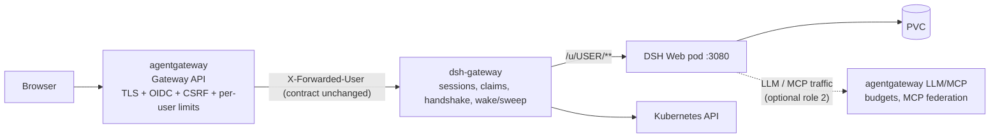

# Evaluating agentgateway as a layer of this platform

Status: **evaluation** (no manifests shipped; nothing here is deployed by the example).
Upstream: <https://agentgateway.dev/docs/kubernetes/latest/documentation/about/>
Basis: agentgateway `main` at `08de0ba` (docs version 1.7 "latest"), read from the
upstream repository's CEL/config schema, CRDs and examples.

## TL;DR

**agentgateway cannot replace the `dsh-gateway`, but it is a good fit for three
narrower jobs around it.** Ranked by value per unit of risk:

| # | Role | Verdict | Why |
| --- | --- | --- | --- |
| 1 | **Public entry point + identity (replaces oauth2-proxy)** | **Recommended** | Native OIDC, JWT, CSRF and per-user rate limiting replace the `oauth2-proxy` hop, and CEL can map identity to the existing `X-Forwarded-User` contract. Keeps the trust boundary we already enforce. |
| 2 | **One LLM/MCP egress door for all sandboxes** | **Recommended, separate concern** | Fixes the platform's biggest real gap (one shared provider key, no spend cap, no tool governance) and retires the per-sandbox provider-key Secret. |
| 3 | **Gateway API implementation for the SSO variant** | **Optional** | Lets the shipped `Gateway`/`HTTPRoute` variant run without a second controller; Traefik already covers it, so this is convenience, not capability. |
| — | **Replacement for `dsh-gateway`'s data plane** | **Not viable today** | Gaps are structural: per-user sandbox routing, the DSH launch-token handshake, server-side revocable sessions, and in-process wake/suspend traffic accounting. |

The one thing agentgateway uniquely *could* take over — routing to the right
per-user sandbox — is a **dynamic backend**, and in Kubernetes mode that is
currently reachable only through agentgateway's "Substrate" actor model
(`substrateIngress`), which is built for a different actor runtime than
agent-sandbox. Treat that as a research spike, not a plan.

---

## 1. What agentgateway is

A data plane (Rust crates, Go controller) delivered as a Gateway API
implementation (`gatewayClassName: agentgateway`) with three traffic families on
one listener:

- **LLM gateway** — OpenAI-compatible front door for OpenAI, Anthropic, Gemini,
  Bedrock and self-hosted models, with budget/spend controls, prompt enrichment,
  load balancing and failover.
- **MCP gateway** — tool federation over stdio/SSE/Streamable HTTP, OpenAPI
  bridging, OAuth for MCP servers.
- **A2A gateway** — agent-to-agent routing.
- **HTTP/TCP/TLS** — ordinary Gateway API routing, so it also works as a normal
  north-south proxy.

Policies attach to `Gateway` → `Listener` → `Route` → `RouteRule` → `Backend`,
merged at runtime with most-specific-wins. Authorization, rate limiting, header
rewriting and logging fields are **CEL expressions** evaluated per request.

Capabilities relevant to this platform that I verified in the CRDs and the CEL
schema:

| Capability | Evidence | Relevance here |
| --- | --- | --- |
| WebSocket upgrades proxied | `timeout.responseIdleTimeout` docs state upgraded WebSocket and CONNECT tunnels are never terminated; both are treated as first-class. | **Required** — DSH needs `/api/remote.mux`. |
| Path rewrite (`urlRewrite.path.prefix`/`full`) | `AgentgatewayPolicy` `traffic.*` | Needed for the `/u/<user>/` prefix. |
| OIDC browser auth with login/logout paths | `examples/traffic-oidc` (`policies.oidc` with `login.path`, `logout`) | Replaces oauth2-proxy. |
| JWT auth with a claims surface (`jwt.sub`) usable in CEL | `examples/traffic-jwt-*`, `schema/cel.md` `jwt.*` | Per-user rate limits, authorization, log fields. |
| CSRF policy | `traffic.csrf` — safe methods allowed, `Sec-Fetch-Site`/`Origin` vs `Host` | Matches the gateway's existing Origin/Referer check. |
| Rate limiting keyed by CEL (`conditional[].key`) | standalone `localRateLimit.conditional[].key` and `rateLimit` in the Policy CRD, e.g. `jwt.sub` | Replaces in-process `AUTH_RATE_LIMIT` / `MAX_IN_FLIGHT_PER_USER`. |
| extAuthz / extProc | `traffic.extAuth` / `extProc` (HTTP and gRPC) | Lets our own auth logic stay authoritative. |
| Header/body transforms in CEL | `traffic.transformation` | Could map `jwt.email` → `X-Forwarded-User`. |
| Dynamic upstream target from CEL | `backends[].dynamic.target` (CEL → `host:port`); `AgentgatewayBackend.spec.dynamicForwardProxy` | **The key gap for us** — see §2. |
| Wake suspended actors on ingress with request parking | `policies.substrateIngress` (`requestParking`, `cacheTtl`, `connectTargetPort`) | Semantically **exactly** our wake-on-connect + suspend, but for "Substrate actors". |
| Substrate / ztunnel-style APIs | `controller/pkg/syncer/README.md` (workload API from ztunnel); `substrateIngress`/`substrateEgress` | Relevant precedent: an agent-sandbox-fronting example already exists. |

A directly relevant precedent: agentgateway ships an
[OpenShell example](https://github.com/agentgateway/agentgateway/tree/main/examples/openshell)
that puts agentgateway in front of **Agent Sandbox** workloads. It is *gRPC over
plaintext HTTP/2* to OpenShell's own supervisor, not a browser HTTP+WS proxy to a
per-user pod, so it does not transfer to DSH.

## 2. Where it fits — the piece-by-piece map

The platform's request path today is
`Browser → (Traefik Ingress | Gateway + oauth2-proxy) → dsh-gateway → DSH pod`.
The `dsh-gateway` does four distinct jobs; agentgateway overlaps with them very
differently.

| Gateway job | Agentgateway equivalent | Fit |
| --- | --- | --- |
| **TLS termination + host routing** | Gateway/Listener, TLS terminate | **Drop-in.** Already delegated to Traefik today. |
| **SSO (oauth2-proxy + `X-Forwarded-User`)** | `traffic.jwtAuthentication` + `oidc` policy + CEL | **Good fit.** One hop instead of two; still leaves `AUTH_PROXY_HEADER` semantics intact. |
| **Auth abuse controls** (`AUTH_RATE_LIMIT`, `MAX_IN_FLIGHT_PER_USER`) | `traffic.rateLimit` with CEL keys, `traffic.csrf` | **Good fit — and genuinely better.** They move from per-replica memory to a shared enforcement point that survives gateway restarts. |
| **Signup / login / logout / delete / recreate routes** | `directResponse`, `extAuthz`, `extProc` | **Poor fit.** An account-management API is not proxy configuration; encoding ~10 HTTP verbs that touch `SandboxClaim` objects in CEL is the wrong tool. |
| **Server-side revocable sessions** (`dsh_gw_session` → in-memory sid table) | `jwtAuthentication` verifies tokens; OIDC cookie is *stateless* | **Gap.** agentgateway verifies a credential; it does not own a revocable server-side session table. Revocation today is an explicit gateway feature (`/logout`, delete, `/recreate`). |
| **`/u/<user>/` → that user's sandbox** | `dynamic.target` CEL / `dynamicForwardProxy` / `substrateIngress` | **Gap — unless §2 works.** Requires knowing which host:port belongs to `alice` right now, *and* waking a suspended sandbox first. |
| **DSH launch-token handshake** (read `pods/log`, replay `?token=`) | `backendAuth.key.expression` (CEL, per request) can inject a credential | **Gap.** The credential must be *found* first: it is discovered by scraping pod logs and depends on request `Host`. CEL has no cluster read. |
| **Wake-on-connect / idle sweep** | `substrateIngress.requestParking` (wake while parked, bounded); no equivalent idle sweep | **Partial / gap.** Wake-on-connect is available only for Substrate actors; nothing in agentgateway watches request idleness per *claim* to suspend one sandbox. |
| **HTTP/SSE/WebSocket proxying** | Core capability | **Excellent fit.** |
| **Kubernetes API access** (`sandboxclaims`, `sandboxes`, `pods/log`) | None — it is a proxy, not a controller for our CRDs | **Structural gap.** Our gateway is a control plane *and* data plane; agentgateway is a data plane plus a generic Gateway API controller. |

### Why the two hard gaps are hard

1. **Per-user dynamic backends are "trusted target", not "cluster-aware".**
   `dynamic.target` is a CEL expression over request context. The documented
   precedent is reading `extProc.workerPodIp` — a value an **extProc callout just
   supplied**. So the shape that works is: *our control plane stays authoritative
   and hands agentgateway the target per request.* Each request would then need an
   extProc round-trip to resolve `user → host:port`, i.e. agentgateway gains a
   hard dependency on a custom extProc service that does what `dsh-gateway`'s
   `resolve()` does today. That is a net increase in moving parts, not a
   simplification.
2. **Kubernetes mode does not expose the escape hatch.** `substrateIngress` and
   `dynamic.target` are in the **standalone/local** config schema; the
   `AgentgatewayPolicy` and `AgentgatewayBackend` CRDs expose neither
   (`dynamicForwardProxy` forwards by `Host`/SNI only, with the CRD's own warning
   that it reaches arbitrary destinations). The only wake-aware, per-actor
   routing path is the Substrate actor model, which is not agent-sandbox.

## 3. Recommended integration: layered, not replacement

The valuable, low-risk shape is **agentgateway as the outer edge, `dsh-gateway`
unchanged behind it**:

This is a **third exposure variant**, not a change to the base manifests — it
fits the existing `manifests/exposure/<variant>/` contract (variants are mutually
exclusive, and like `ingress/` and `gateway-api-sso/` it ships its own
`kustomization.yaml`, README and NetworkPolicy).

### Why the variant's identity contract survives

The gateway's SSO design already assumes a single trusted hop that asserts
identity and is the *only* path to the Service. agentgateway's OIDC policy keeps
the same shape:

- Gateway Service stays **ClusterIP**, reachable only from agentgateway pods.
- agentgateway terminates TLS, runs the OIDC code flow, and forwards
  identity in `X-Forwarded-User` — either via
  `traffic.transformation.request.set` / `add` from `jwt.sub`, or by keeping
  oauth2-proxy behind it if the org's IdP needs its feature set.
- `AUTH_PROXY_HEADER=X-Forwarded-User` stays exactly as it is; **no gateway code
  change is required**, and the `aaas.example.com/token-sha256` claim marker
  keeps refusing hand-applied or foreign claims.
- `TRUSTED_PROXY_HOPS` becomes **1** (one agentgateway hop appending to
  `X-Forwarded-For`) instead of 2. `scripts/preflight-sso.sh` must gain a branch
  for the new chain.

### What it buys, concretely

| Today | With agentgateway in front |
| --- | --- |
| Two proxies to debug (Traefik + oauth2-proxy) plus the gateway | One edge proxy plus the gateway |
| `AUTH_RATE_LIMIT` is per-replica memory; a restart resets it | `rateLimit` with `key: jwt.sub` enforced at the edge, shared and restart-proof |
| `MAX_IN_FLIGHT_PER_USER` is per-replica and counts only proxied traffic | CEL-keyed concurrency/rate limits evaluated before the request reaches the gateway |
| Origin/`Host` check implemented in our Python | `traffic.csrf` policy, no code |
| No audit trail of who hit what | Access logs with CEL fields (`user.id: jwt.sub`), metrics, traces |

### What it does not buy, and what it costs

- **An extra hop** on the hot path (`/u/<user>/` × every asset + the WS), including
  a second WebSocket proxy in series. Needs a WebSocket soak test.
- **A new operator dependency**: agentgateway CRDs (Gateway API CRDs already
  pinned in `versions.env`), a controller, and an `AgentgatewayPolicy` version to
  pin. The project is pre-1.0 (`v1.x` docs, `v1alpha1` CRDs), so pinning it in
  `versions.env` — not floating "latest" — is mandatory per AGENTS.md rule 2.
- **Two authentication systems still run**: OIDC at the edge for SSO *and* the
  gateway's own cookie/token auth. For the SSO variant that is already true of
  oauth2-proxy today, so the cost is unchanged — it is just no longer two
  separate hop configs.

## 4. The independent, higher-value fit: one LLM/MCP door

This is **not** about the gateway at all, and it is the strongest reason to
adopt agentgateway in this repository eventually. The platform's documented
weakest security property is that every sandbox shares provider keys
(`dsh-provider-keys` + `dsh-provider-keys-extra`) and reaches provider APIs
directly over public HTTPS. That means: no per-tenant budget, no spend cap, no
model allow-list, no audit of which sandbox called what, and a key that is
readable in every sandbox.

agentgateway's LLM and MCP planes turn that into a controlled egress door:

- Sandboxes stop holding provider keys and call one in-cluster endpoint.
- The gateway holds the key (or a per-sandbox virtual key), enforces
  per-tenant budget and model allow-lists, and logs usage per sandbox.
- MCP tool access becomes federated and authorised (this is also the natural
  home for the optional agent-sandbox MCP server, which is currently
  explicitly *not* internet-facing because it has no authentication).
- It composes with the existing `manifests/optional/network-policy/`: sandbox
  egress could narrow from "DNS + all public HTTPS" to "DNS + agentgateway" —
  a real narrowing of the tenant blast radius.

This belongs in its own optional component (an `optional/` manifest set plus a
hardening-doc section), with an explicit note that going through a shared proxy
moves trust from the sandbox to the proxy. It does **not** need the exposure
variant and can ship independently.

## 5. What I would not do

- **Do not swap the data plane for `HTTPRoute` + `dynamicForwardProxy`.** The
  per-user target still needs log-scraping and wake/suspend coordination; the
  proxied `Host` must stay the browser's, and the launch token must never be a
  set of CEL expressions. This trades a tested 1,900-line gateway with unit
  tests for a config that cannot express its two riskiest steps.
- **Do not model the account API in CEL.** `POST /users`, `/recreate` and
  `DELETE /users/{user}` mutate `SandboxClaim` objects; they are not routing.
- **Do not enable the mesh/Substrate/keyless egress modes as a first step.**
  They are new subsystems with their own prerequisites (mTLS identities, a
  workload control plane) that duplicate `agent-sandbox`'s job.

## 6. Spike plan (time-boxed, throwaway)

If the SSO-replacement variant is pursued, the cheapest falsification sequence
is:

1. **Kind cluster + agentgateway controller only**; one `Gateway` +
   `AgentgatewayPolicy` with OIDC against a local Keycloak (the
   `examples/traffic-oidc` + `traffic-oauth2-proxy` upstream configs are the
   reference), forwarding to a stub that echoes `X-Forwarded-User`.
   *Kill criterion:* CEL cannot set the header the way the gateway's SSO path
   expects.
2. **WebSocket soak**: replace the stub with a real DSH sandbox, open
   `/u/<user>/api/remote.mux` through agentgateway → `dsh-gateway` → pod, hold
   it for an hour with idle gaps. *Kill criterion:* idle timeouts or any frame
   corruption — the gateway's documented failure mode is precisely about
   WebSocket/streaming proxies that buffer or time out.
3. **Rate-limit parity**: confirm a `rateLimit` keyed on `jwt.sub` produces the
   same per-user isolation `MAX_IN_FLIGHT_PER_USER` gives, before advertising
   that it can replace it.
4. **Only then** write `manifests/exposure/agentgateway/` (Gateway +
   AgentgatewayPolicy + NetworkPolicy + README + `kustomization.yaml`), update
   `manifests/exposure/README.md`, extend `scripts/preflight-sso.sh`, add the pin
   to `versions.env`, render it with `kubectl kustomize`, and run the full
   `make e2e` walkthrough — the same bar every other exposure variant meets.

## 7. Impact on the existing architecture decisions

| ADR | Effect of the recommended integration |
| --- | --- |
| ADR-1 (Starlette ASGI) | Unchanged — the gateway keeps owning HTTP/WS bridging. |
| ADR-2 (path-based `/u/<user>/`) | Unchanged — the edge must pass `/u/**` through intact; no `urlRewrite` on that route. |
| ADR-3 (launch-token handshake) | Unchanged — still the least durable part, and still the reason agentgateway cannot be the only proxy. |
| ADR-4 (in-memory state, single replica) | **Partially relieved**: auth rate limits and CSRF move to the edge. Sessions, idle clocks and the handshake cache stay in-process, so the replica constraint remains. |
| ADR-5 (claims as the user record) | Unchanged. |
| ADR-6 (opaque server-side sessions) | Unchanged. Agentgateway verifies identity; it does not own revocation. |
| Evolution path step 4 (ingress-level rate limits, audit logging) | **Directly advanced** — this is the cheapest way to satisfy it. |
| Evolution path step 3 (per-tenant keys / egress proxy) | **Directly advanced** by the LLM/MCP door. |

## 8. Bottom line

Adopt agentgateway **around** the `dsh-gateway`, not instead of it, and in order:
(1) optional LLM/MCP egress door — biggest security win, no gateway risk;
(2) optional `exposure/agentgateway/` SSO variant replacing oauth2-proxy —
fewer hops, durable auth limits; (3) keep the data plane. Revisit replacement only
if agentgateway exposes per-user dynamic routing **and** a cluster-aware backend
in Kubernetes mode; until then the launch-token handshake and the wake/suspend
bookkeeping keep the gateway where it is.
