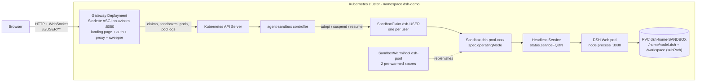
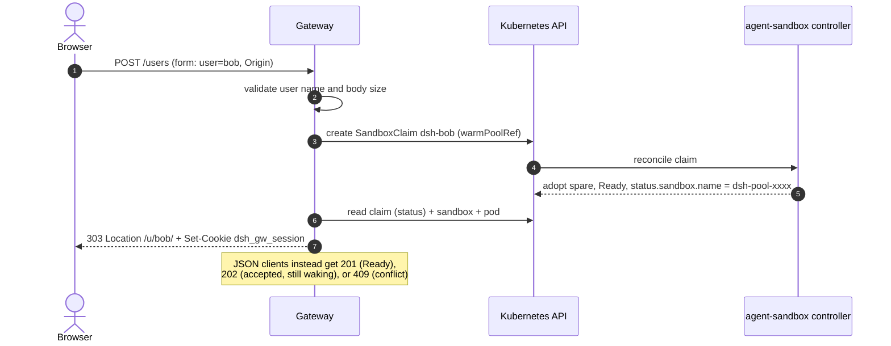
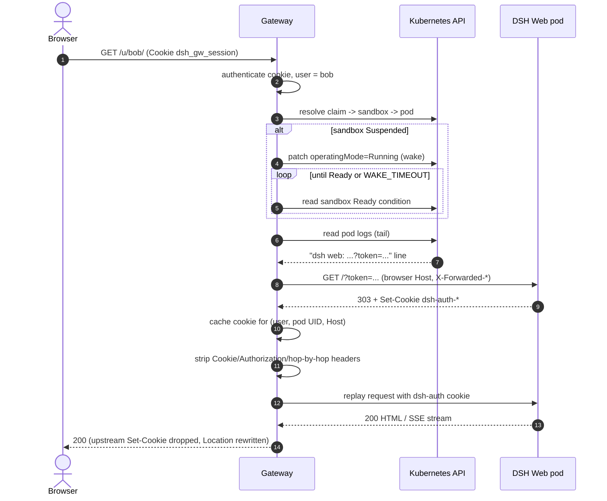
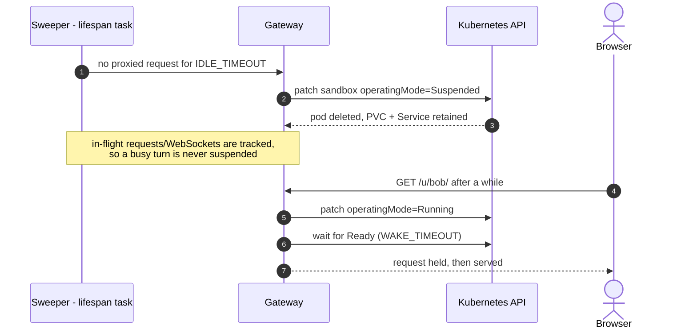
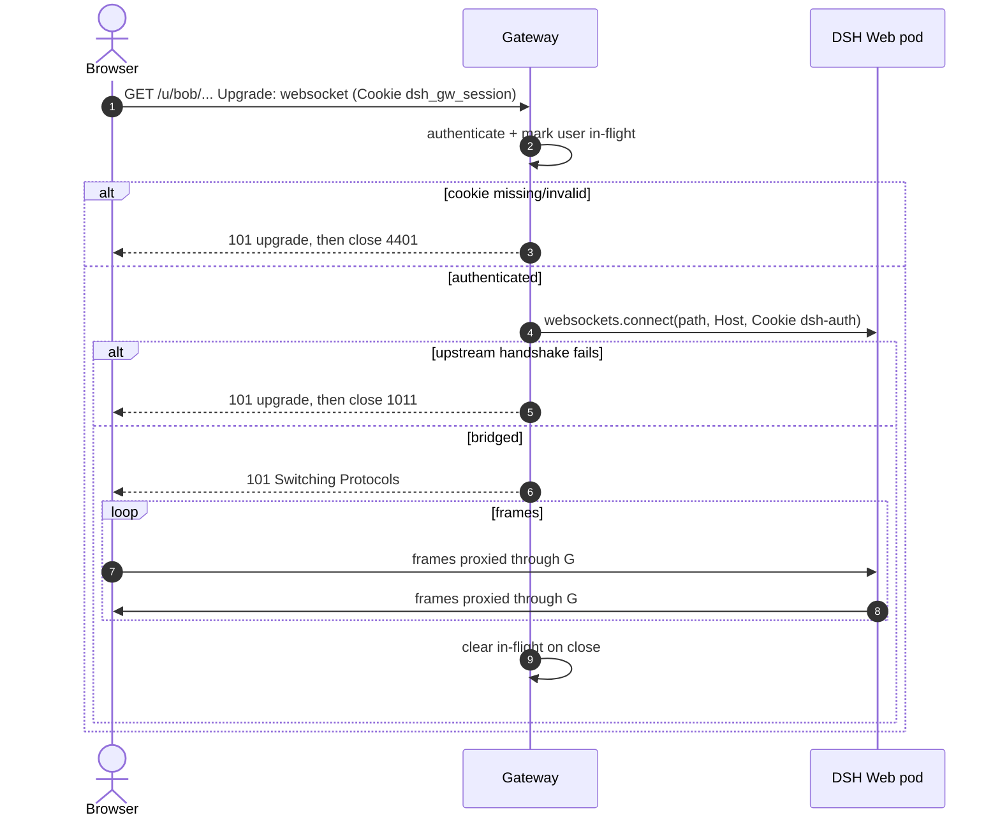

# Architecture

This document describes the browser-usable **agents-as-a-service** platform in this example
([README](../README.md), [manifests](../manifests/), [gateway](../gateway/)): how the gateway,
Kubernetes, and DSH Web fit together, and why the design looks the way it does.

Scope: one Kubernetes namespace (`dsh-demo`), one shared DSH Web image, one gateway deployment,
and one DSH Web pod + PVC per user. The cluster is assumed to run
[agent-sandbox](https://github.com/kubernetes-sigs/agent-sandbox) with the pinned
`AGENT_SANDBOX_VERSION` from [`versions.env`](../../../versions.env) and the extensions
(`SandboxTemplate`, `SandboxWarmPool`, `SandboxClaim`).

## Container view

Responsibilities:

| Component | Responsibility |
| --- | --- |
| **Browser** | Holds only the gateway session cookie (`dsh_gw_session`). Talks exclusively to the gateway. |
| **Gateway** | Signup/login, session auth, `SandboxClaim` lifecycle, wake-on-connect, idle sweeper, HTTP/SSE/WebSocket reverse proxy, DSH launch-token handshake. |
| **Kubernetes API** | Source of truth for claims, sandboxes, and pods; also the log source for the DSH launch token. |
| **agent-sandbox controller** | Adopts warm spares on claim, flips `operatingMode` (Running/Suspended), garbage-collects sandbox + PVC on claim delete. |
| **DSH Web pod** | One `dsh web` process per user, DSH state and the agent workspace on the per-user PVC (`/home/node/.dsh` + `/workspace`), listening on `3080`. |
| **Warm pool** | Keeps `N` Ready sandboxes so signup is a label flip instead of a cold start. |

## Exposure variants

The base manifests deploy the gateway as a ClusterIP Service (`dsh-gateway:8080`) and expose
nothing outside the cluster. Two **mutually exclusive** variants live under
[`manifests/exposure/`](../manifests/exposure/):

| Variant | Entry point | Authentication | Notes |
| --- | --- | --- | --- |
| [Ingress](../manifests/exposure/ingress/60-ingress.yaml) | Traefik `Ingress` + optional TLS | the gateway's own signup/session cookie | simplest; no external IdP; set `COOKIE_SECURE=true` with HTTPS |
| [Gateway API + SSO](../manifests/exposure/gateway-api-sso/70-gateway.yaml) | Gateway API `Gateway`/`HTTPRoute` terminating TLS | GitHub OAuth via [oauth2-proxy](../manifests/exposure/gateway-api-sso/72-oauth2-proxy.yaml), identity forwarded as `X-Forwarded-User` | requires `AUTH_PROXY_HEADER` on the gateway; the trust boundary applies |

They are alternatives, not a stack: applying both creates a second path to the same gateway
and defeats SSO. When SSO is enabled, the Service must stay ClusterIP and be reachable only
through oauth2-proxy — otherwise any client can send `X-Forwarded-User` itself and be treated
as that user. The gateway ignores the header unless `AUTH_PROXY_HEADER` is set. See the
[exposure README](../manifests/exposure/README.md) and the
[gateway README](../gateway/README.md#sso-opt-in).

Each variant also ships a NetworkPolicy: `ingress/61-networkpolicy.yaml` limits gateway ingress
to Traefik pods, and `gateway-api-sso/75-networkpolicies.yaml` limits the gateway to
oauth2-proxy, oauth2-proxy ingress to the Gateway implementation, and oauth2-proxy egress to
DNS/public HTTPS/the gateway. The SSO policy turns the trust boundary into pod-traffic
enforcement; the caveats (Traefik label, `hostNetwork`, kubelet probes) are in
[optional hardening](optional-hardening.md).

## Flows

### Signup (browser)

Form signup waits up to `WAKE_TIMEOUT` for the claim to become `Ready`, then redirects; the
first proxied request also waits for `Ready` and performs the DSH handshake (below). A `409`
means the user already has a claim, in which case `POST /login` (bearer token) or the existing
cookie is the right path.

### First request / proxy (with handshake)

Handshake cache behavior: one entry per `(user, pod UID, Host)`; refreshed once when DSH answers
`401`; dropped when the sandbox is suspended or deleted. The launch token and the DSH auth
cookie never reach the browser.

Inside `proxy_http` the order is auth, in-flight slot, sandbox resolution/wake, DSH handshake,
body read, upstream send. An upload aborted mid-body may therefore already have paid for a wake
and a handshake, but it never reaches DSH.

### Wake-on-connect and idle suspend

Suspend deletes only the pod. The PVC keeps conversations, sessions, config **and the agent
workspace**, so resume reattaches exactly the same state. Both trees live on one PVC: DSH state at
`/home/node/.dsh` (the volume root) and the workspace at `/workspace` (a second mount of the same
volume with `subPath: workspace`, which keeps `.credentials.yaml` out of the agent-visible tree).
The idle sweeper never touches the volume; deleting the claim still garbage-collects it, so
`POST /recreate` wipes state and workspace together.

**Workspace as home.** The template sets `HOME=/workspace`. DSH has no start-path setting for its
directory picker: the browse backend lists `$HOME` when the dialog opens, so with the image default
(`/home/node`, off the PVC) the picker would start on a throwaway directory. The override makes the
picker open on the persisted workspace and makes `~` resolve there; the cost is that tool caches
and config kept under `$HOME` (`npm`/`pnpm`, `uv`, `git`, `gh`, and DSH's global `~/.agents`
instructions and skills) become dotfiles in the workspace. `DSH_HOME` stays `/home/node/.dsh`, so
sessions, config and credentials remain outside the agent-visible tree. Pod env is stamped when a
sandbox is created, so an existing sandbox keeps the old `HOME` until it is recreated.

**Ownership boundary.** The gateway shares its namespace with claims created outside it — the
example's resource-layer walkthrough applies `dsh-alice` by hand, and every claim is named
`dsh-<user>`. Claims the gateway creates carry `aaas.example.com/managed-by=dsh-gateway`; the
sweeper skips everything else, so it can never suspend a sandbox an operator is using. Without
that marker the sweeper would suspend a hand-applied claim 60s after first sighting and break
`kubectl logs`/`port-forward` against its pod.

**Resume and file ownership.** The pod template sets `fsGroupChangePolicy: OnRootMismatch` on
purpose. DSH's credentials plugin refuses to boot when `.credentials.yaml` has any group/other
permission bit (it creates the file `0600`). The kubelet's default fsGroup policy (`Always`)
recursively ORs `0660` into every file on each pod start, so the first resume of a sandbox would
crash-loop with `mode 660`. `OnRootMismatch` only rewrites ownership/permissions when the volume
root does not already match the fsGroup, which it does after the first mount — so suspend/resume
keeps working. Sandboxes snapshot their pod template, so an updated `SandboxTemplate` does not
retroactively change existing ones.

### WebSocket

## Decisions and trade-offs

### ADR-1: Starlette ASGI instead of a sync Flask proxy

- **Decision:** implement the gateway as a Starlette app served by `uvicorn
  gateway:create_app --factory`.
- **Why:** the browser needs WebSocket upgrades, streaming SSE responses, and concurrent
  long-poll wake requests. A requests-based Flask proxy cannot upgrade connections and blocks
  workers while a sandbox wakes.
- **Cost:** async code paths and explicit bridging for the sync `kubernetes` client (offloaded
  to threads). Accepted: one small service, one framework.

### ADR-2: Path-based routing (`/u/{user}/`) instead of per-user subdomains

- **Decision:** serve each user under `https://gateway/u/{user}/`.
- **Why:** one hostname, one TLS certificate, no wildcard DNS or per-user Ingress objects. DSH
  uses relative asset/API URLs and injects `<base href="./">`, so a path prefix works; the
  gateway rewrites absolute-path `Location` headers and redirects `/u/{user}` to
  `/u/{user}/`.
- **Cost:** any upstream code that emits root-absolute URLs would need rewriting; cookie
  domains are shared (mitigated by stripping DSH `Set-Cookie`). If DSH ever changes its base
  handling, per-user subdomains are the fallback.

### ADR-3: Server-side launch-token handshake instead of exposing the token

- **Decision:** the gateway reads DSH's launch token from pod logs, performs the token
  handshake itself, caches DSH's auth cookie, and authenticates the browser with its own
  `HttpOnly` cookie.
- **Why:** DSH has no token API and returns `401` on `/` without the launch-token cookie.
  Handing the token to the browser would put it in URLs, history, and logs, and would let users
  bypass gateway auth.
- **Cost:** log reading permission and a brittle parser; see [Upstream feature
  request](#upstream-feature-request-remove-log-scraping). This is the least durable part of the
  design and the first thing to replace.

### ADR-4: In-memory state, single replica

- **Decision:** idle clocks, handshake cache, and in-flight tracking live in gateway memory;
  the Deployment runs one replica.
- **Why:** the simplest thing that works, with no extra datastore for a demo/reference
  platform.
- **Cost:** a restart forgets idle timers (sandboxes stay Running until their next request) and
  the handshake cache; two replicas would double-suspend and race. Scaling out requires moving
  this state to a shared store (Redis/Postgres) or leader election. Documented instead of
  hidden.

### ADR-5: Claims as the user record

- **Decision:** a user is a `SandboxClaim` named `dsh-<user>`; the bearer-token SHA-256 lives in
  a claim annotation, and the gateway marks its own claims with
  `aaas.example.com/managed-by=dsh-gateway`.
- **Why:** no database, no separate account service; deleting the claim is account deletion and
  cascades everything. The ownership annotation keeps a namespaced claim list safe to share with
  objects created by hand or by other controllers.
- **Cost:** no password reset, no admin API, no audit log of its own; Kubernetes API load grows
  with users. Claims created before the ownership marker existed must be annotated
  (`kubectl annotate sandboxclaim ...`) to keep being swept. Fine for a reference pattern, not
  for a product.

### ADR-6: Gateway cookie session instead of bearer tokens in the browser

- **Decision:** browsers get `dsh_gw_session=<user>:<token>`, `HttpOnly`, `SameSite=Lax`
  (`Secure` when enabled); API clients may still use `Authorization: Bearer`.
- **Why:** tokens never appear in URLs or JS-readable storage, and `SameSite=Lax` plus a strict
  `Origin`/`Referer` check on cookie-authenticated mutations blocks basic CSRF.
- **Cost:** cookie-based auth needs TLS and correct `COOKIE_SECURE`; there is no signed-cookie
  layer, so the gateway trusts the token hash comparison for validation.

## Security and RBAC

The gateway runs with a namespace-scoped ServiceAccount (`manifests/50-gateway.yaml`):

| API group | Resource | Verbs | Why |
| --- | --- | --- | --- |
| `extensions.agents.x-k8s.io` | `sandboxclaims` | `get`, `list`, `create`, `delete` | signup, state, account deletion |
| `agents.x-k8s.io` | `sandboxes` | `get`, `list`, `patch` | resolve DNS/pod, wake/suspend |
| `""` (core) | `pods` | `get`, `list` | resolve the pod behind a sandbox |
| `""` (core) | `pods/log` | `get` | launch-token handshake |

Notes and limits:

- **Pod logs are sensitive.** They contain the DSH launch token and possibly model output. The
  permission is scoped to one namespace, but anyone who can read gateway memory or logs can
  impersonate users. Prefer the upstream token API when available.
- **No cluster-wide access, no secret reads.** The gateway does not read `dsh-provider-keys`.
- **Browser-facing hardening:** `HttpOnly`/`SameSite=Lax`/optional `Secure` cookies,
  timing-safe SHA-256 token comparison, strict same-origin check on cookie-auth mutations,
  request-body limit (`MAX_BODY_MB`), hop-by-hop header stripping, upstream `Set-Cookie`
  dropped, DSH `Location` headers rewritten under `/u/<user>/`.
- **Host allow-list:** DSH rejects unknown `Host` headers. The gateway forwards the browser's
  `Host`, so every public hostname must be in `DSH_TRUSTED_HOSTS`; `localhost`/`127.0.0.1` are
  always trusted.
- **TLS is external.** The gateway serves plain HTTP; terminate TLS at the Ingress and set
  `COOKIE_SECURE=true`. Without TLS, session cookies are replayable on the network.
- **Tenant isolation** is pod + PVC separation; all tenants share one namespace, one DSH binary,
  and the shared provider keys (`dsh-provider-keys` plus the optional
  `dsh-provider-keys-extra`). `manifests/optional/network-policy/` adds an opt-in sandbox
  NetworkPolicy, and gVisor/`nodeSelector` are opt-in PodSpec fields. Add per-tenant
  credentials before calling it multi-tenant-grade.
- **DSH's inner file sandbox is disabled by deployment override.** The template sets
  `DSH_PERMISSION_MODE=danger-full-access` because the in-container backends are unusable here:
  `bubblewrap` ships in the image but is unsetuid and cannot create an unprivileged user namespace
  under the pod's seccomp/capability surface, and no Landlock runner is available; the confined
  executor would otherwise fail closed on every command. The pod remains the boundary, so an
  agent can read its own `DSH_HOME`. Hosts with a working backend can keep a confined mode.
- **Optional hardening is opt-in.** gVisor, node selection, the sandbox/exposure NetworkPolicies,
  extra provider keys and failed-Pod recovery are documented in
  [optional hardening](optional-hardening.md). The base manifests stay portable (no gVisor
  RuntimeClass, no active node labels, no NetworkPolicy, no extra Secret required, and the
  controller's default `failedPodPolicy: Retain`).
- **No gateway rate limiting.** Signup can create claims until the cluster or warm pool is
  exhausted; put limits at the ingress for real deployments.

## Failure modes

| Failure | Symptom | Behavior / mitigation |
| --- | --- | --- |
| DSH log line changed or rotated away | Proxy returns `503` (missing launch token) | Fix the parser or restart the pod so the token line is re-emitted |
| Probe on `/` | Pod `CrashLoopBackOff`, `401` in probe logs | Use `/favicon.svg` for readiness/liveness (shipped templates do) |
| Warm pool exhausted | JSON signup returns `202` (state `Waking`); form signup is slow | Increase `replicas` in the warm pool |
| Gateway restart | Idle sandboxes stop suspending; handshake cache lost | Rebuilt lazily on next request; consider a shared store for production |
| Browser aborts a request (tab reload, back navigation) during a slow wake or handshake | No response reaches the client; nothing appears in the access log | If the abort lands before the response starts, the body read raises `ClientDisconnect` and the app answers `499` (`CLIENT_CLOSED_REQUEST`), which cannot reach the departed peer. Nothing reached DSH, no ERROR traceback is logged, and the in-flight slot is released. A request already streaming ends with its upstream status. |
| DSH auth cookie expired mid-session | Proxy `401` once, then recovers | Gateway refreshes the handshake once |
| Upstream pod name changed after resume | Cached cookie keyed by old pod UID is useless | Cache is invalidated on suspend; next request re-handshakes |
| Two gateway replicas | Double suspend/wake races | Keep `replicas: 1` until state is externalized |
| Optional NetworkPolicy blocks DNS/probes | Sandbox 502/503, pod restarts, failed `getent` | Check the CNI, DNS selector/NodeLocal address and kubelet-probe traffic; see the hardening doc |
| gVisor + `kubectl port-forward` | Forward refuses or returns nothing | Port-forward is incompatible with gVisor; use the gateway or a reachable Service |
| Provider key added but missing in the pod | Requests still fail with `MISSING_CREDENTIAL` | Pod env is stamped at creation; recreate spares/pods. A stored credential wins over env |
| `nodeSelector` matches no node | Pod `Pending`, `0/N nodes are available` | Fix the label, pool capacity or taint/toleration; RuntimeClass scheduling may also constrain it |
| Sandbox Pod reaches phase `Failed` (node eviction, spot reclaim) | Sandbox reports `Finished=True`; the gateway keeps failing against a dead Pod | Set `failedPodPolicy: Recreate` (agent-sandbox v1.0.8+) so the controller replaces the Pod with the same identity and PVCs; otherwise delete the Pod by hand. See the hardening doc |

## Upstream feature request: remove log scraping

DSH should expose the launch token as a first-class, machine-readable interface so platforms do
not need `pods/log` access. Proposed shapes (any one suffices):

1. **Token file:** `dsh web --token-file /run/dsh/token` writes the current launch token (mode
   `0600`) and rewrites it on rotation.
2. **Environment input:** accept `DSH_LAUNCH_TOKEN` (platform-generated) so the token never
   has to be discovered.
3. **Loopback/trusted-host endpoint:** `GET /api/auth/launch-token` that only answers on the
   pod's loopback or a trusted host and returns the token plus expiry.
4. **Token in a well-known file** under `DSH_HOME` with the same semantics as (1).

Why this matters: log scraping is brittle (rotation, restart, format changes), requires a broad
`pods/log` permission that also exposes application output, and can leak tokens into log
pipelines. Until an upstream API exists, the gateway's parser, `DSH_LOG_TAIL_LINES`, and the
single-retry refresh are the supported workaround.

## Evolution path

1. Replace log scraping with the upstream token API (above), deleting the `pods/log` permission.
2. Move idle clocks, in-flight tracking, and handshake cache to a shared store; then scale the
   gateway horizontally (sticky routing not required if state is shared).
3. Add per-tenant API keys or an egress proxy so a single key is not shared by all sandboxes.
4. Add NetworkPolicies (gateway → sandboxes only), TLS everywhere, rate limits, and audit
   logging at the ingress.
5. If DSH grows absolute URLs or per-user cookies that cannot be rewritten, switch to
   per-user subdomains with wildcard DNS/TLS.
